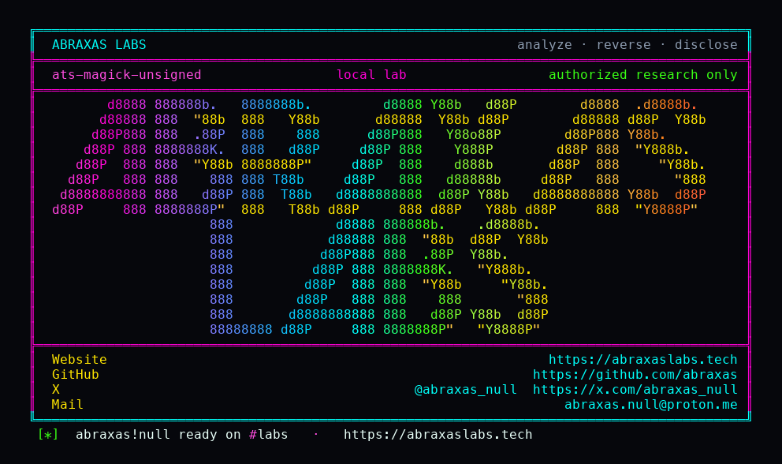

<p align="center">
  
</p>

<p align="center">
  <a href="https://abraxaslabs.tech"><strong>abraxaslabs.tech</strong></a>
  &nbsp;·&nbsp;
  <a href="https://github.com/abraxas">github.com/abraxas</a>
  &nbsp;·&nbsp;
  <a href="https://x.com/abraxas_null">@abraxas_null</a>
  &nbsp;·&nbsp;
  <a href="mailto:abraxas.null@proton.me">abraxas.null@proton.me</a>
  &nbsp;·&nbsp;
  <a href="https://github.com/abraxas/ats-magick-unsigned">ats-magick-unsigned</a>
</p>
<p align="center">
  Write-up: <a href="https://abraxaslabs.tech/research/ats-magick-unsigned"><strong>https://abraxaslabs.tech/research/ats-magick-unsigned</strong></a>
</p>


# ats-magick-unsigned

**Class:** File write
**Reach:** Remote

**Apache Traffic Server** `10.2.0` (`b1df7334`) - Apache Software Foundation

experimental magick runs ImageMagick `ConvertImageCommand` from `?magick=` (percent+base64 convert argv) when `plugin.config` has no RSA key. `verified = nullptr == key_`. The README states the key exists to avoid being exploited. Loading `magick.so` with no args is the plugin default.

Signed CONTROL with an RSA public key on `plugin.config` is 403, no witness file. Class stays File write. Distro `policy.xml` often disables URL/shell delegates. Do not inflate to RCE.

| | |
|---|---|
| ID | no CVE yet |
| Class | **File write** (unsigned convert argv) |
| Reach | **Remote** (unauth HTTP `?magick=` through magick.so with no key) |
| CWE | [CWE-347](https://cwe.mitre.org/data/definitions/347.html), [CWE-73](https://cwe.mitre.org/data/definitions/73.html) |
| CVSS | **High: 7.5** `CVSS:3.1/AV:N/AC:L/PR:N/UI:N/S:U/C:N/I:H/A:N` |
| Product | [Apache Traffic Server](https://github.com/apache/trafficserver) |
| Affected | **10.2.0** (`b1df7334b39a878971c376da849e8da4984918b6`) experimental magick unsigned convert |
| Auth | none |
| License | [GNU Affero GPL v3.0](LICENSE) |
| Lab | `127.0.0.1:18800` only |

I pinned public tag [10.2.0](https://github.com/apache/trafficserver/releases/tag/10.2.0) peel [b1df7334](https://github.com/apache/trafficserver/commit/b1df7334b39a878971c376da849e8da4984918b6). The lab is a source-built `ats-10.2.0-lab:local` reverse proxy on loopback. Unsigned convert `-write png:/tmp/oracle/ATS-MAGICK-UNSIGNED-WITNESS`. Witness file 161 bytes owner nobody. Signed CONTROL 403.

## What an attacker can do

Unauth `GET /img.png?magick=` against an origin image of a compatible Content-Type, with `magick.so` loaded and no RSA key.

| Method | Sink | Privilege |
|---|---|---|
| Unauth `GET /img.png?magick=` unsigned convert `-write png:/tmp/oracle/ATS-MAGICK-UNSIGNED-WITNESS` | `verified = nullptr == key_` ([`magick.cc:593-609`](https://github.com/apache/trafficserver/blob/b1df7334b39a878971c376da849e8da4984918b6/plugins/experimental/magick/magick.cc#L593-L609)) then `ConvertImageCommand` | **Integrity / File (lab-proven):** 161-byte witness file owner **nobody**. Logs `ImageMagick's syntax`. HTTP 200. |
| Same query with RSA key on `plugin.config` | `EVP_DigestVerify` | **Closed (lab-proven):** 403 signature verification failed. No witness file. |
| Huge origin blob | unbounded `blob_` | **Availability (inferred):** process memory pressure. Sibling of CVE-2026-58186 cap. Not this High row. |
| IM URL / shell delegates | `policy.xml` | **Closed in this lab:** HTTP/HTTPS/URL/MVG/shell delegates none. Do not call it RCE. |

**Lab-proven vs inferred:** unsigned file write as nobody, signed 403, syntax log are lab. Unbounded blob DoS is inferred. RCE is not claimed.

**Requires:** experimental `magick.so` without a verify key, plus ImageMagick `policy.xml` that still allows the convert path write. Not loaded in default `plugin.config`.

## Adjacent surface that stays closed

| Surface | Lab |
|---|---|
| magick loaded **with** an RSA public key | CONTROL 403, `control-sigfail=yes`, no file |
| magick not loaded | query `magick` is inert |
| wasm WASI `path_open` | NOENT |
| Request body as IM input | origin **response** blob is the input |
| webp_transform bound decode | CVE-2026-58186 closed; magick blob is the sibling that was not bounded |

Not CVE-2026-58186. Magick README already said the key exists to avoid being exploited. The leftover is loading the plugin without that key.

## Lab

```bash
python3 ats-magick-unsigned-Abraxas-Labs.py
```

or

```bash
cd lab
./run.sh
```

Loopback `127.0.0.1:18800` (signed CONTROL on a second listener). Compose project `ats-magick-unsigned`. Image `ats-10.2.0-lab:local`. Witness `ATS-MAGICK-UNSIGNED-WITNESS`. Last line:

```
SUCCESS ats-magick-unsigned unsigned-http=200 file-write=yes uid=nobody syntax-log=true control-http=403 control-sigfail=yes ATS-MAGICK-UNSIGNED-WITNESS
```

## The fix

Fail closed when `key_` is null. Do not run `ConvertImageCommand` on client `?magick=` without a verified `magickSig`. Treat a missing key as "plugin misconfigured", not "unsigned convert is fine". Cap `blob_` the way webp_transform was capped.

Until then, do not load `magick.so` without a production-size RSA public key. Distro `policy.xml` is not a substitute for the signature.

## References

- [github.com/apache/trafficserver](https://github.com/apache/trafficserver) tag [10.2.0](https://github.com/apache/trafficserver/releases/tag/10.2.0) (`b1df7334b39a878971c376da849e8da4984918b6`)
- [`plugins/experimental/magick/magick.cc`](https://github.com/apache/trafficserver/blob/b1df7334b39a878971c376da849e8da4984918b6/plugins/experimental/magick/magick.cc) `verified = nullptr == key_`
- [`plugins/experimental/magick/README`](https://github.com/apache/trafficserver/blob/b1df7334b39a878971c376da849e8da4984918b6/plugins/experimental/magick/README)
- Sibling (closed, not this): CVE-2026-58186 webp_transform bound decode
- [CWE-347](https://cwe.mitre.org/data/definitions/347.html) · [CWE-73](https://cwe.mitre.org/data/definitions/73.html)
